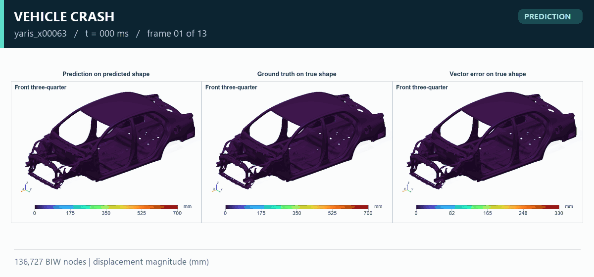
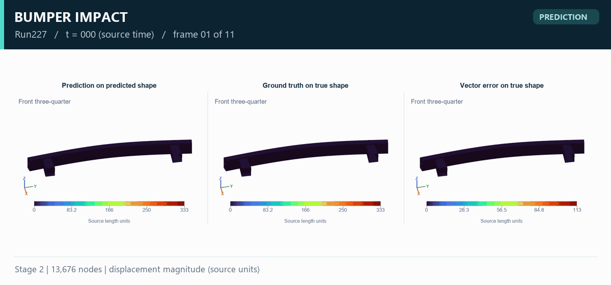
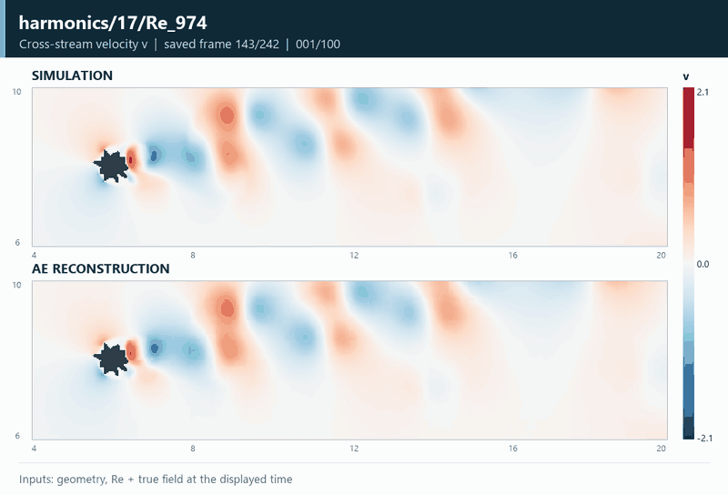
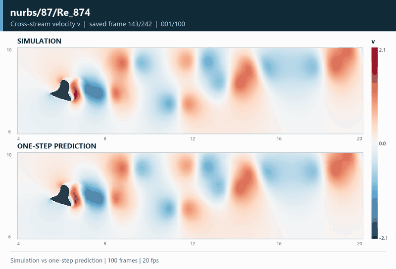

  <h1>TPLD-Surrogates</h1>
  
<strong>AI surrogate models for structural and fluid dynamics</strong>

  
From geometry and conditions to time-dependent physical fields.

  
<a href="#showcase">Showcase</a> · <a href="#research">Research</a> · <a href="docs/methodology.md">Methodology</a> · <a href="CONTRIBUTING.md">Contributing</a>

  
<a href="README.md">简体中文</a> | <strong>English</strong>

**TPLD-Surrogates** presents [TSYGAI](https://github.com/TSYGAI)'s research in surrogate modeling for vehicle crash, structural impact, and flow around complex geometries. Our work explores spatial representations, latent dynamics, and full-field response prediction. The showcase presents research cases, high-resolution field plots, and animations, with the inputs, task, physical quantities, and units explained in each case study.

## TPLD-Surrogates in Action

<table>
<tr><th width="50%">Vehicle Crash</th><th width="50%">Bumper Impact</th></tr>
<tr><td></td><td></td></tr>
<tr><td><strong>Condition-driven transient prediction.</strong> 136,727 BIW nodes, 0–120 ms. <a href="docs/car-crash.md">Case study →</a> · <a href="assets/car-crash/full-comparison.png">Full comparison</a></td><td><strong>One-shot trajectory prediction.</strong> 13,676 nodes; source length and time units. <a href="docs/bumper.md">Case study →</a> · <a href="assets/bumper/full-comparison.png">Full comparison</a></td></tr>
<tr><th>Flow Reconstruction</th><th>Flow Prediction</th></tr>
<tr><td></td><td></td></tr>
<tr><td><strong>Spatial field representation.</strong> Simulation and reconstruction at 20 fps. Four geometry types and eight test conditions. <a href="docs/flow-reconstruction.md">Geometry and Re reconstruction gallery →</a> · <a href="docs/flow-cases/harmonics-17-Re-974.md">Full u / v / p comparisons</a></td><td><strong>Simulation versus one-step prediction.</strong> 100 consecutive target frames; each prediction uses two true historical fields. <a href="docs/flow-prediction.md">Geometry and Re prediction GIF gallery →</a> · <a href="docs/flow.md">Task details</a></td></tr>
</table>

Structural animations show predictions from known conditions. Flow reconstruction uses the current true field; each flow prediction uses the two preceding true fields. The 100-frame animation is not a 100-step free rollout. Flow GIFs show cross-stream velocity v with a shared fixed color scale; case pages include u / v / p and error maps. Playback time is illustrative; no temporal interpolation is used.

## Research Focus

- Predict nonlinear structural responses from geometry, design variables, and initial conditions.
- Learn compact representations of mesh-based and grid-based physical fields.
- Study temporal evolution in latent space and decode full-field responses.
- Separate reconstruction, history-conditioned prediction, and condition-only prediction in evaluation.

## Full-field Temporal Surrogate Models

- **Observe spatial distributions.** Examine structural deformation, flow patterns, and local errors across the physical domain.
- **Represent geometry and conditions.** Describe engineering problems with meshes, signed distance fields, design variables, and known conditions.
- **Connect space and time.** Combine spatial encoding, temporal modeling, and coordinate decoding to study evolving responses and complete trajectories.
- **Compare physical fields.** Present model outputs alongside simulation truth and error maps, with traceable material sources.

## Research and Contact

We welcome discussion on structural transient responses, flow around complex geometries, scientific machine learning, and engineering applications. Use Issues for technical questions and Pull Requests to contribute cases or documentation.

**Company email:** [zhangyuan@cocasoft.com](mailto:zhangyuan@cocasoft.com)

This release contains research cases and presentation assets. Training code, full datasets, and checkpoints are outside this release. See [NOTICE](NOTICE.md) for material provenance and usage notes.
