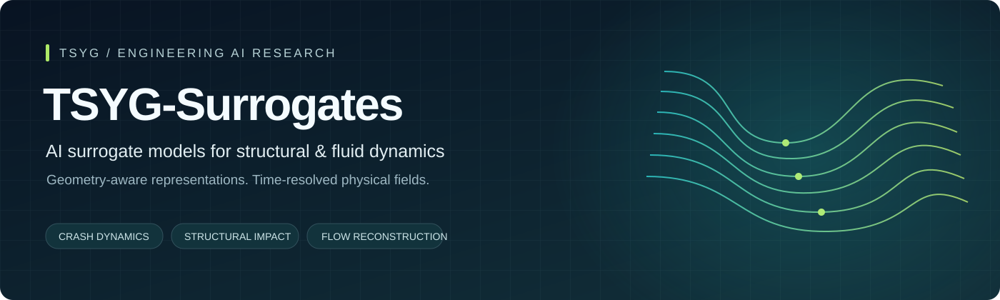
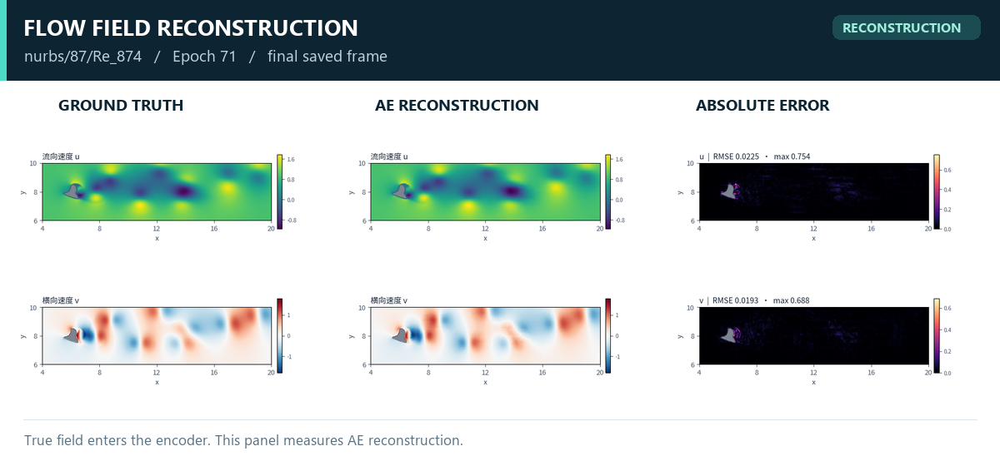
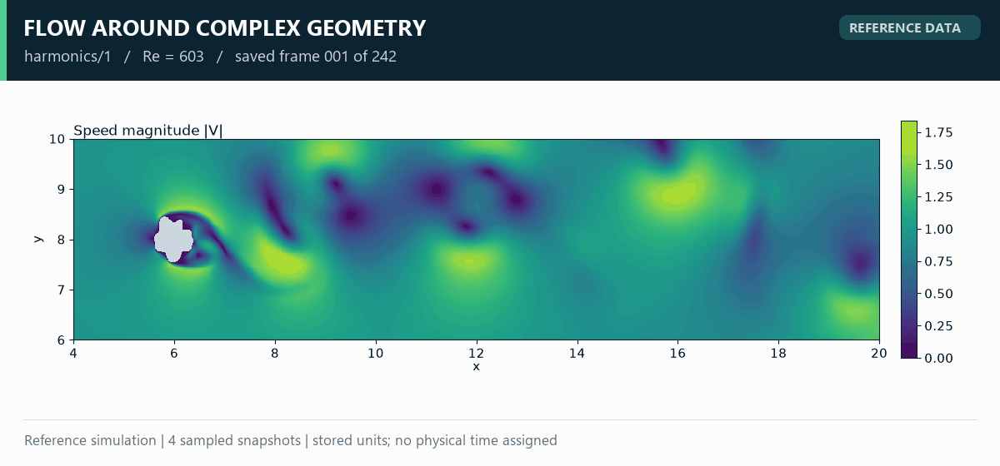
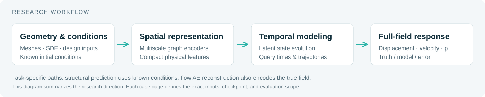

  
  <h1>TSYG-Surrogates</h1>
  
<strong>AI surrogate models for structural and fluid dynamics</strong>

  
From geometry and conditions to time-dependent physical fields.

  
<a href="#showcase">Showcase</a> · <a href="#results">Evaluation</a> · <a href="docs/methodology.md">Methodology</a> · <a href="CONTRIBUTING.md">Contributing</a>

  
<a href="README.md">简体中文</a> | <strong>English</strong>

**TSYG-Surrogates** presents [TSYGAI](https://github.com/TSYGAI)'s research in surrogate modeling for vehicle crash, structural impact, and flow around complex geometries. Our work explores spatial representations, latent dynamics, and full-field response prediction. Every result identifies its task, checkpoint, and evaluation scope.

## TSYG-Surrogates in Action

<table>
<tr><th width="50%">Vehicle Crash</th><th width="50%">Bumper Impact</th></tr>
<tr><td></td><td></td></tr>
<tr><td><strong>Condition-driven transient prediction.</strong> 136,727 BIW nodes, 0–120 ms. <a href="docs/car-crash.md">Case study →</a> · <a href="assets/car-crash/full-comparison.png">Full comparison</a></td><td><strong>One-shot trajectory prediction.</strong> 13,676 nodes; source length and time units. <a href="docs/bumper.md">Case study →</a> · <a href="assets/bumper/full-comparison.png">Full comparison</a></td></tr>
<tr><th>Flow Reconstruction</th><th>Reference Flow Dynamics</th></tr>
<tr><td></td><td></td></tr>
<tr><td><strong>Spatial field representation.</strong> Truth / AE reconstruction / absolute error. <a href="assets/flow/reconstruction-full.png">Full u / v / p comparison →</a></td><td><strong>Reference simulation data.</strong> Re = 603, 1024 × 256 grid, four saved snapshots. <a href="assets/flow/reference-time-sequence.png">Speed and pressure snapshots →</a></td></tr>
</table>

Structural animations show predictions from known conditions. The flow comparison is true-field-conditioned reconstruction. The flow animation shows reference simulation data. Playback is slowed for presentation; no intermediate states are synthesized.

## Research Focus

- Predict nonlinear structural responses from geometry, design variables, and initial conditions.
- Learn compact representations of mesh-based and grid-based physical fields.
- Study temporal evolution in latent space and decode full-field responses.
- Separate reconstruction, history-conditioned prediction, and condition-only prediction in evaluation.

## Evaluation Snapshot

| Task / checkpoint | Evaluation scope | Verified result |
| :--- | :--- | :--- |
| Car Crash · Stage 3 | 18 validation cases; 13 frames per case | 136,727 nodes; 248,601 triangles; per-case, per-frame spatial R² provided |
| Bumper · Stage 2 | 7 validation cases; 10 future frames per case | Mean per-case displacement-magnitude R² **0.999615**; mean vector RMSE **3.5167 source length units** |
| Flow · Epoch 95 reconstruction | 85 test cases; 20,570 valid frames | Relative L2, u / v / p: **1.373% / 3.247% / 3.500%** |
| Flow · Epoch 95 one-step prediction | 85 test cases; 20,230 windows; two true historical fields as input | Relative L2, u / v / p: **1.370% / 3.240% / 3.531%** |

Flow errors are averaged equally across cases. The displayed flow comparison uses Epoch 71, while the newer numeric evaluation uses Epoch 95. One-step results do not establish long-horizon free-rollout accuracy. See [evaluation definitions](docs/results.md), [machine-readable results](results/summary.json), and [asset provenance](results/provenance.json).

## Explore the Repository

The [case studies](docs/methodology.md) document the inputs, outputs, units, and limitations. The [contribution guide](CONTRIBUTING.md) describes contributing from a personal account to the TSYGAI organization. Detailed case documentation is currently in Chinese.

This release contains presentation assets and evaluation summaries. Training code, full datasets, and checkpoints are outside this release. See [NOTICE](NOTICE.md) for material provenance and usage notes. The README organization takes inspiration from [NVIDIA PhysicsNeMo](https://github.com/NVIDIA/physicsnemo); TSYG-Surrogates is an independent project.
