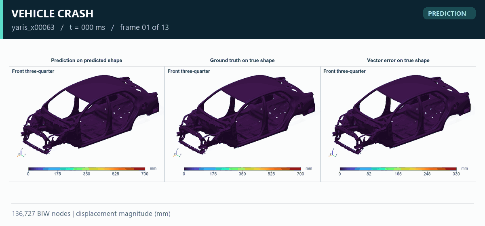
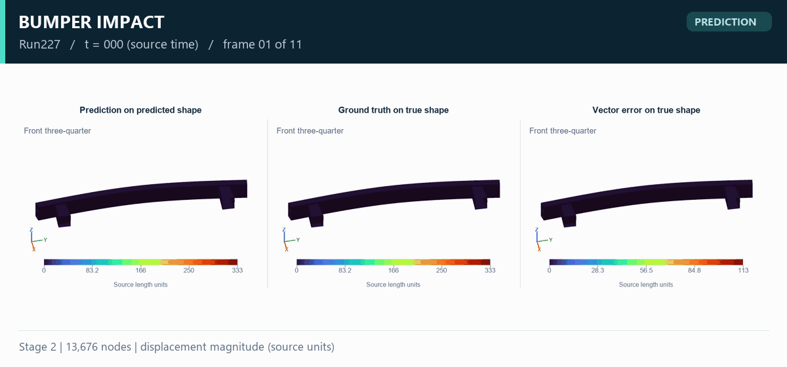
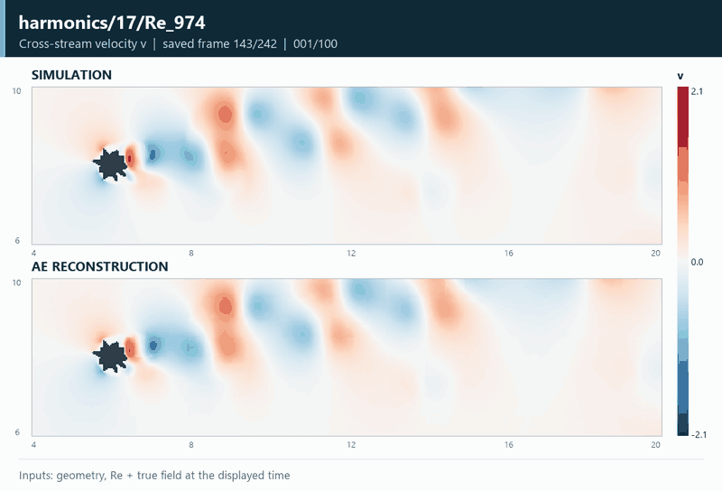
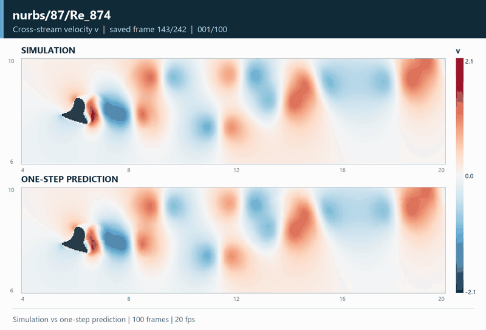
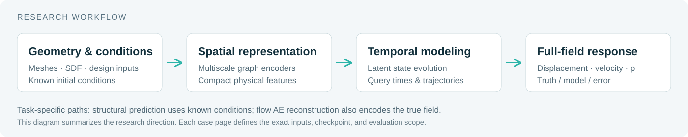

  <h1>TPLD-Surrogates</h1>
  
<strong>面向结构动力学与流体动力学的人工智能代理模型</strong>

  
从几何与工况，到随时间演化的物理场。

  

    <a href="#showcase">研究案例</a> ·
    <a href="#research">研究方向</a> ·
    <a href="docs/methodology.md">方法与文档</a> ·
    <a href="CONTRIBUTING.md">参与贡献</a>
  

  
<strong>简体中文</strong> | <a href="README.en.md">English</a>

**TPLD-Surrogates** 汇集 [TSYGAI](https://github.com/TSYGAI) 在车辆碰撞、结构冲击与复杂几何流动中的代理模型研究成果。我们研究物理场的空间表示、潜空间时序演化与全场响应预测，并通过仿真真实值、模型结果和误差对照呈现研究进展。

本仓库提供研究案例、高清云图和动态演示，展示结构与流体物理场的空间分布及时间演化。各案例说明模型输入、任务类型、物理量与单位。

## TPLD-Surrogates in Action

<table>
  <tr>
    <th width="50%">车辆碰撞 · Vehicle Crash</th>
    <th width="50%">保险杠冲击 · Bumper Impact</th>
  </tr>
  <tr>
    <td></td>
    <td></td>
  </tr>
  <tr>
    <td><strong>三维瞬态响应预测</strong> 初始白车身几何与设计条件 → 后续位移场。136,727 个节点，展示完整保存时间序列。 <a href="docs/car-crash.md">案例说明 →</a> · <a href="assets/car-crash/full-comparison.png">四视角高清图</a></td>
    <td><strong>结构冲击整轨迹预测</strong> 静态工况、初始网格与时间轴 → 结构响应。13,676 个节点，展示预测、真实值及误差。 <a href="docs/bumper.md">案例说明 →</a> · <a href="assets/bumper/full-comparison.png">四视角高清图</a></td>
  </tr>
  <tr>
    <th>流场重建 · Flow Reconstruction</th>
    <th>绕流演化 · Flow Prediction</th>
  </tr>
  <tr>
    <td></td>
    <td></td>
  </tr>
  <tr>
    <td><strong>复杂几何下的物理场表示</strong> 仿真流场与空间重建同步播放，100 个连续帧、20 fps。四类几何、八个 Re 工况，观察不同尾迹与横向速度结构。 <a href="docs/flow-reconstruction.md">不同形状与 Re 的重建图集 →</a> · <a href="docs/flow-cases/harmonics-17-Re-974.md">u / v / p 高清对比</a></td>
    <td><strong>仿真与单步预测对比</strong> 每次输入两帧真实历史流场，展示 100 个连续时刻的单步预测。统一色标对照圆钝形、多瓣形、细长形与不对称形绕流。 <a href="docs/flow-prediction.md">不同形状与 Re 的预测动图 →</a> · <a href="docs/flow.md">案例说明</a></td>
  </tr>
</table>

**读图说明：** 结构案例为条件驱动的后续响应预测；流场重建输入当前真实场；流场单步预测输入前两帧真实场，100 帧动画不表示 100 步自由滚动。流场动画显示横向速度 v，高清图提供 u / v / p。GIF 播放速度用于演示，未进行时间插值。点击流场图片可浏览更多几何与 Re 工况。

## 研究方向

| 方向 | 研究问题 | 当前展示 |
| :--- | :--- | :--- |
| **结构动力学代理模型** | 如何从结构几何、设计参数与初始条件预测非线性瞬态响应？ | 白车身碰撞、保险杠冲击的三维位移场与误差分析 |
| **物理场空间表示** | 如何在网格与复杂流体域上压缩、重建高维物理场？ | 多尺度空间表示，以及速度、压力重建结果 |
| **潜空间动力学** | 如何在紧凑表示上学习响应随时间的演化？ | 结构整轨迹预测；Flow 使用真实历史场的单步预测评估 |
| **物理场对照分析** | 如何观察预测场、真实场与局部误差的空间分布？ | 多视角云图、时序动画与素材来源 |

## 全场时序代理模型

- **从标量指标走向空间分布。** 同时观察结构变形、流场分布与局部误差，分析不同区域的响应。
- **让几何与工况进入模型。** 以网格、SDF、设计变量和已知条件表达工程问题。
- **连接空间与时间。** 将空间编码、时序建模与坐标解码组合，研究连续响应与整段轨迹。
- **让结果能够核对。** 展示真实值和误差，保留评估口径与来源记录。

## 研究与交流

欢迎围绕结构瞬态响应、复杂几何流动、科学机器学习评估与工程应用开展讨论。可通过仓库 Issues 提出技术问题，或通过 Pull Request 补充案例与文档。

**公司联系邮箱：** [zhangyuan@cocasoft.com](mailto:zhangyuan@cocasoft.com)

本仓库当前发布研究案例与展示素材；训练代码、完整数据集与模型权重不包含在此版本中。材料来源与使用说明见 [NOTICE](NOTICE.md)。
