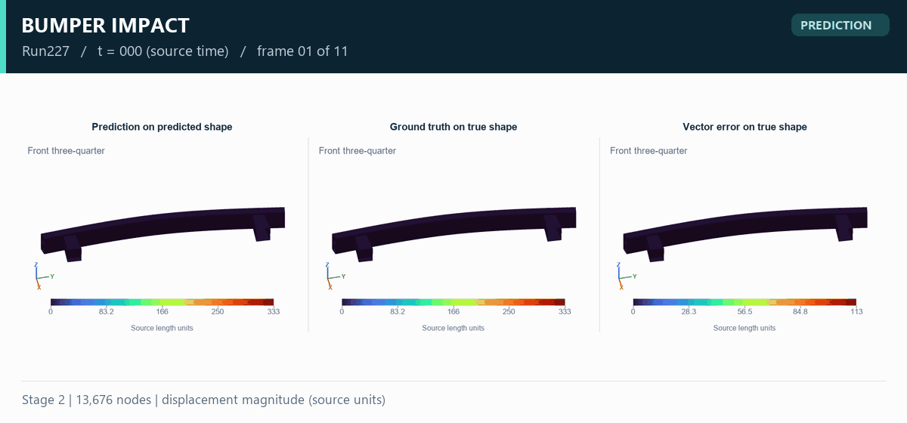
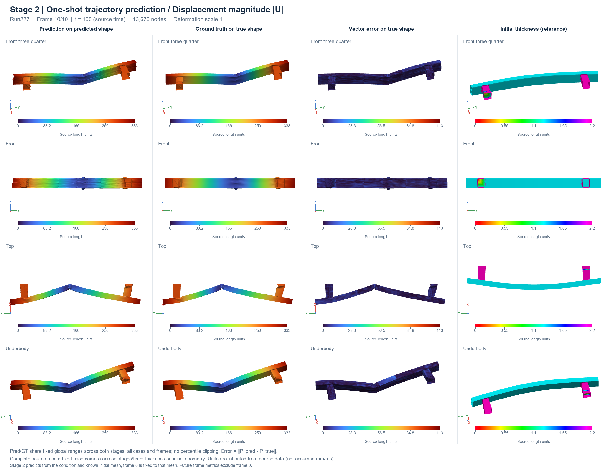
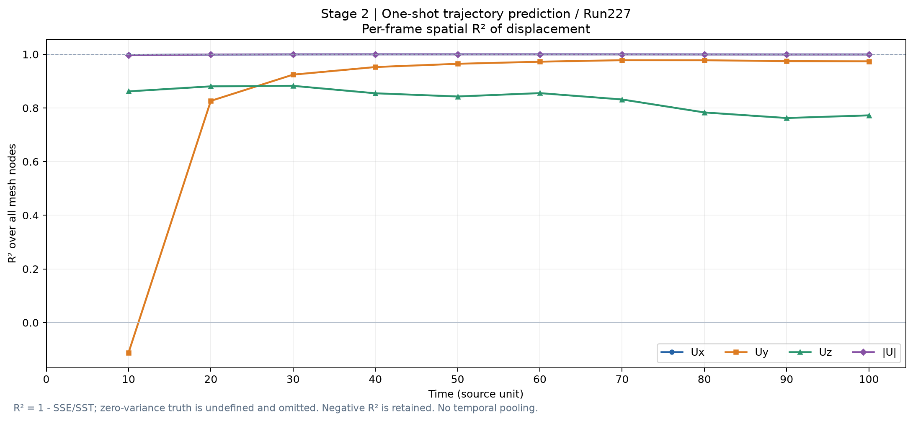

# 保险杠冲击：结构整轨迹预测

[返回主页](../README.md) · [English overview](../README.en.md)

## 任务与评估范围

Stage 2 只使用静态工况、已知初始网格和时间轴预测整条轨迹，不使用真实未来响应。网络输出绝对位置 `P`，位移按 `U=P−X0` 计算。

| 项目 | 内容 |
| :--- | :--- |
| 本地研究项目 | `131_bumper` |
| 图册版本 | `Bumper_Visualization`，2026-10-29 |
| 模型 | Stage 2，最佳检查点第 615 轮；训练日志共 800 轮 |
| 验证工况 | Run224–Run230，共 7 个独立验证工况 |
| 网格 | 每工况 13,676 个节点 |
| 时间帧 | 0、10、…、100，共 11 帧；采用源时间单位 |
| 单位 | 源长度单位与源时间单位；数据来源未确认 mm/ms |
| 演示工况 | Run227 |

Stage 1 将真实响应编码后重建，用于衡量空间表示能力；Stage 2 执行条件驱动的未来预测。两阶段的输入不同。本页展示 Stage 2。

## 高清云图

[打开原始分辨率图片](../assets/bumper/full-comparison.png)

动图保留首个视角的预测、真实值和向量误差；原图还包含其他视角与初始厚度参考。完整网格、形变比例 1；预测和真实值采用相同的固定色标。GIF 包含全部 11 个保存帧，不插入中间状态。

## 评估结果

统计每个工况的 10 个未来帧，排除已知初始帧，然后对 7 个工况等权平均：

| 指标 | 结果 | 归约与含义 |
| :--- | ---: | :--- |
| 位移幅值 R² 的工况均值 | 0.999615 | 每个工况先合并未来帧与节点，对 `||U||` 计算 R²，再对工况取均值 |
| 向量 RMSE 的工况均值 | 3.5167 | `sqrt(mean(||P_pred−P_true||²))`，单位为源长度单位 |
| 绝对位置相对 L2 的工况/通道均值 | 1.059% | 分母是绝对位置；该值不能直接解释为位移相对误差 |

上表的跨时刻 R² 与下图的逐帧空间 R² 归约不同。各方向位移、绝对位置与合位移也具有不同的误差定义，应分别阅读。

- [Stage 2 各工况完整未来帧指标](../results/bumper-stage2.json)
- [两阶段逐帧 R²、SSE、SST、RMSE 与 MAE](../results/bumper-per-frame.csv)（按 `stage` 字段区分）
- [素材来源与 SHA-256](../results/provenance.json)

全部验证推理使用 CPU、FP32；这些结果反映当前检查点在已记录验证工况上的表现。
