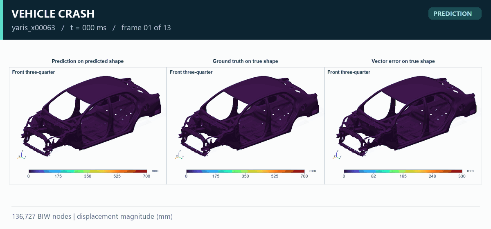
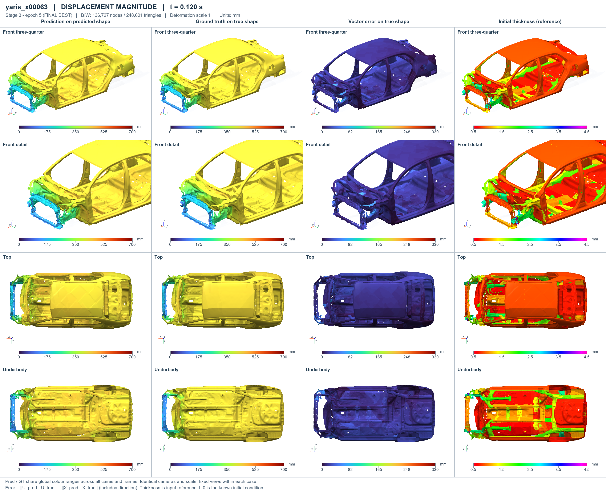

# 车辆碰撞：三维瞬态位移代理模型

[返回主页](../README.md) · [English overview](../README.en.md)

## 任务与案例信息

模型根据初始白车身几何、设计参数、已知初始位移 `U(0)=0` 与查询时间轴预测后续位移场。推理不输入真实未来响应。

| 项目 | 内容 |
| :--- | :--- |
| 本地研究项目 | `100_Car_Crash` |
| 验证范围 | 18 个工况，每工况 13 个保存帧 |
| 时间 | 0–120 ms，保存间隔 10 ms |
| 网格 | 136,727 个节点，248,601 个三角面片；完整白车身网格 |
| 场与单位 | `Ux, Uy, Uz` 及合位移 `||U||`，单位 mm |
| 演示工况 | `yaris_x00063`，用于案例展示 |

动图按原始保存顺序包含全部 13 帧，未插值。播放速度经过放慢，末帧停留便于观察。三列分别为预测构型上的预测合位移、真实构型上的真实合位移、真实构型上的向量误差。

## 高清云图

[打开原始分辨率图片](../assets/car-crash/full-comparison.png)

原图保留四个视角和初始厚度参考列。形变比例为 1，网格未简化。预测和真实值共享色标；向量误差采用独立色标，因此不能仅比较不同列的颜色深浅。

动图为原始科学图中首个视角的裁切与缩小版本，预测、真实值、误差及色标均保留。GIF 的 256 色量化适合网页预览；精细读图请使用 PNG。
