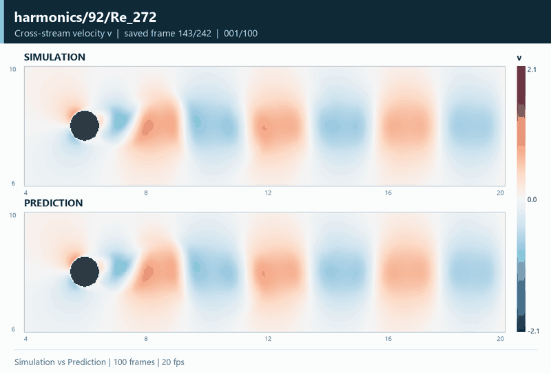
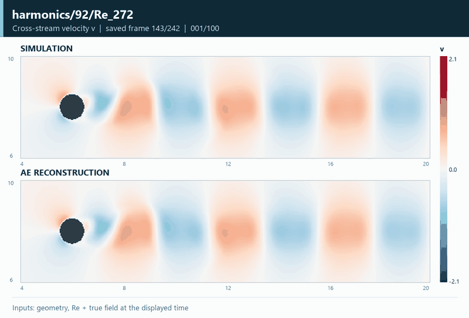

# 圆钝形 · harmonics/92/Re_272

[主页](../../README.md) · [绕流预测图集](../flow-prediction.md) · [流场重建图集](../flow-reconstruction.md)

该工况来自固定测试集。关注：圆钝物体后的交替尾迹。下方分别展示预测与空间重建的流场对比。

## 仿真与预测

仿真与预测逐帧对照，连续展示 100 个保存时刻。

[打开末帧 u / v / p、预测与误差高清图](../../assets/flow/gallery/harmonics-92-Re-272/prediction-fields.png)

## 仿真与空间重建

当前时刻的真实场进入编码器，图中对比仿真场与同一时刻的自编码器重建。

[打开末帧 u / v / p、重建与误差高清图](../../assets/flow/gallery/harmonics-92-Re-272/reconstruction-fields.png)

两组动画都展示原始保存序号 143–242 的 100 个连续帧，每帧 50 ms（20 fps）；播放时间仅用于网页演示。动画显示横向速度 v，所有工况和时刻共用固定色标，深灰色为固体。原始网格 1024 × 256，网页素材从每个方向每隔一个节点取样为 512 × 128，不插入时间中间帧。模型来源与导出记录见 [素材记录](../../results/flow-gallery.json)。
