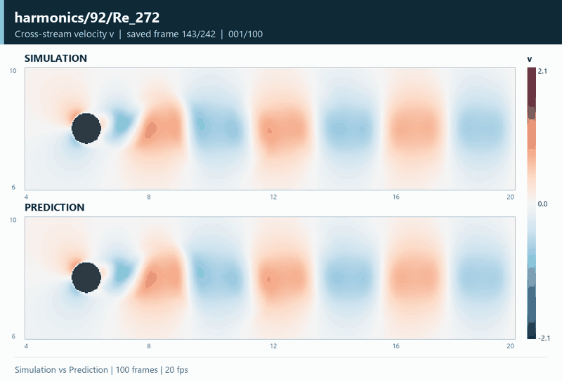
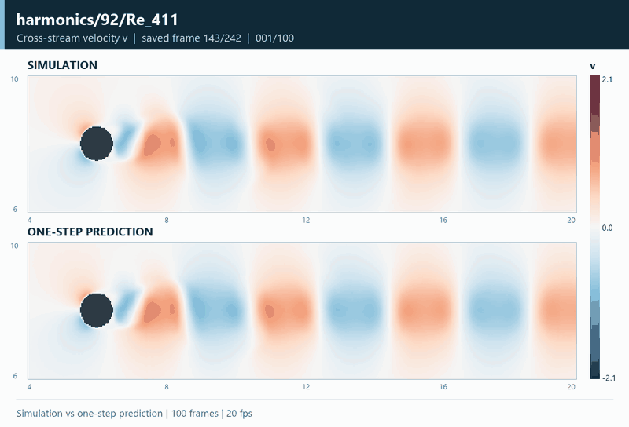
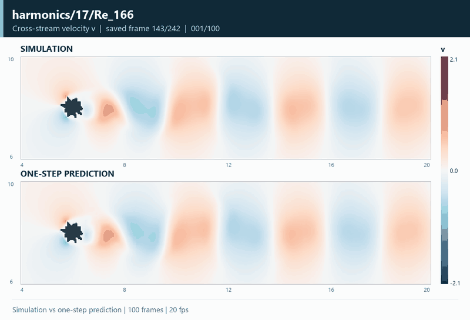
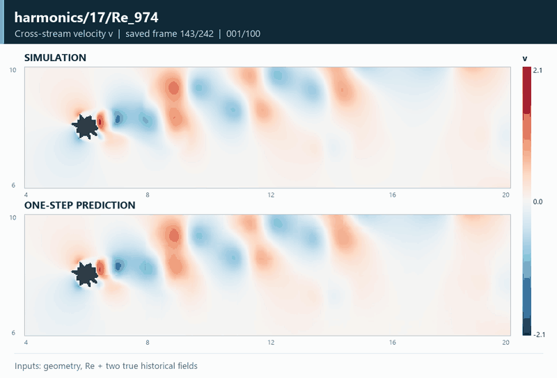
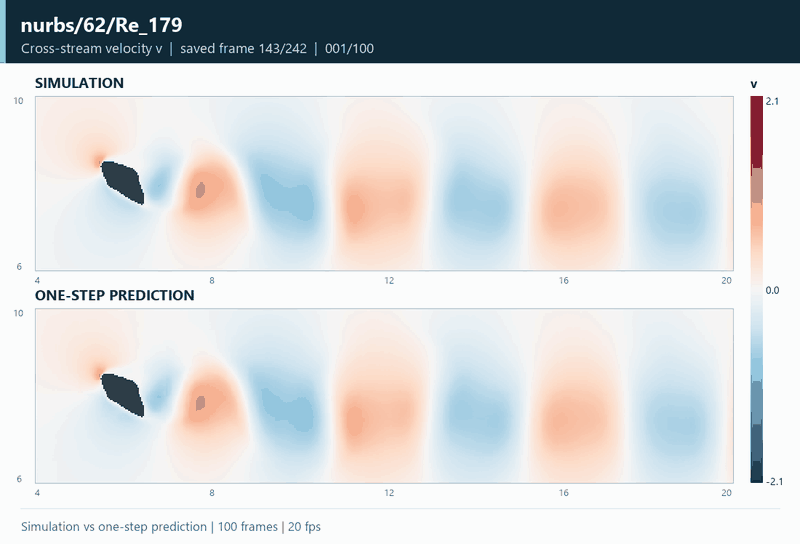
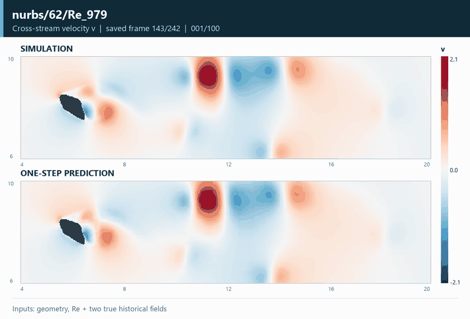
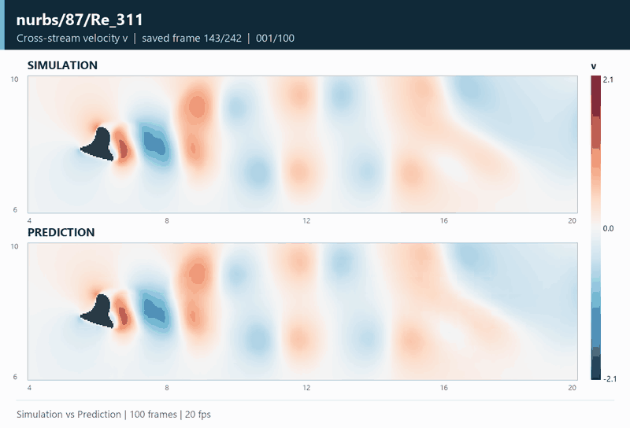
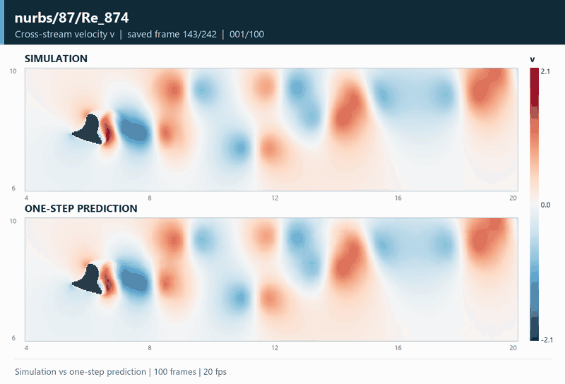

# 绕流演化：仿真与预测

[返回主页](../README.md) · [Flow 研究说明](flow.md) · [另一组对比图集](flow-reconstruction.md)

对比不同物体形状与雷诺数下的仿真流场和预测结果，观察尾迹随时间的变化。

四类几何、八个测试工况，每段 GIF 都包含 **100 个连续保存帧，以 20 fps 播放**。下图展示横向速度 v，以便观察交替尾迹、偏转与横向变化。所有动画共用同一固定色标，仿真与模型结果严格对齐；点击动图可进入该工况的预测、重建与 u / v / p 高清对比。

案例按几何形状、Re 覆盖和仿真流场特征选择，未按模型误差筛选。形状名称用于帮助浏览；不同 Re 的流动变化应结合具体几何阅读。

## 圆钝形 · harmonics/92

<table>
<tr><th width="50%">Re = 272</th><th width="50%">Re = 411</th></tr>
<tr><td></td><td></td></tr>
<tr><td>圆钝物体后的交替尾迹 <a href="flow-cases/harmonics-92-Re-272.md">查看该工况完整对比 →</a></td><td>较高 Re 下的尾迹间距与横向扩展 <a href="flow-cases/harmonics-92-Re-411.md">查看该工况完整对比 →</a></td></tr>
</table>

## 多瓣形 · harmonics/17

<table>
<tr><th width="50%">Re = 166</th><th width="50%">Re = 974</th></tr>
<tr><td></td><td></td></tr>
<tr><td>多瓣边界后的近尾迹发展 <a href="flow-cases/harmonics-17-Re-166.md">查看该工况完整对比 →</a></td><td>偏转尾迹与不规则横向速度结构 <a href="flow-cases/harmonics-17-Re-974.md">查看该工况完整对比 →</a></td></tr>
</table>

## 细长形 · nurbs/62

<table>
<tr><th width="50%">Re = 179</th><th width="50%">Re = 979</th></tr>
<tr><td></td><td></td></tr>
<tr><td>倾斜细长物体后的尾迹 <a href="flow-cases/nurbs-62-Re-179.md">查看该工况完整对比 →</a></td><td>较大尺度的尾迹摆动与疏密变化 <a href="flow-cases/nurbs-62-Re-979.md">查看该工况完整对比 →</a></td></tr>
</table>

## 不对称形 · nurbs/87

<table>
<tr><th width="50%">Re = 311</th><th width="50%">Re = 874</th></tr>
<tr><td></td><td></td></tr>
<tr><td>不对称边界引起的偏转与交替响应 <a href="flow-cases/nurbs-87-Re-311.md">查看该工况完整对比 →</a></td><td>丰富的尾迹速度结构与横向变化 <a href="flow-cases/nurbs-87-Re-874.md">查看该工况完整对比 →</a></td></tr>
</table>

原始保存序号为 143–242（零基索引 142–241），未进行时间插值。每段循环结束后返回第一帧。原始网格 1024 × 256；导出时两个方向均每隔一个节点取样至 512 × 128。色标为数据原始存储尺度，时间不换算为未经核实的物理秒数。详细来源见 [导出记录](../results/flow-gallery.json)。
