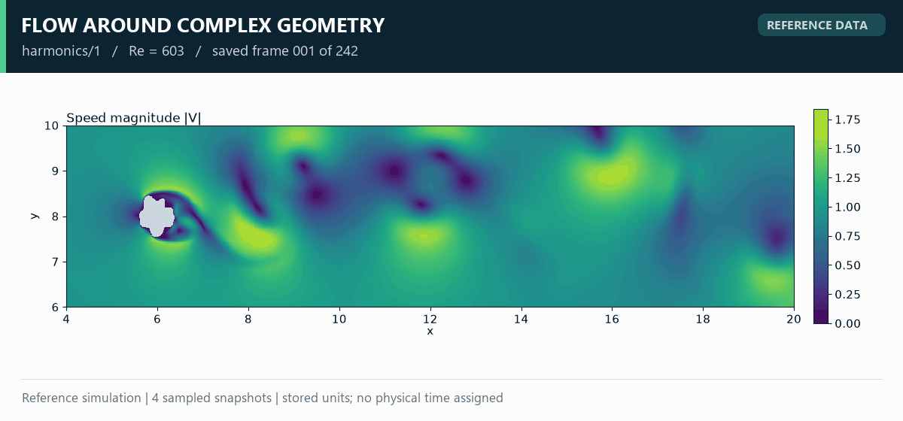
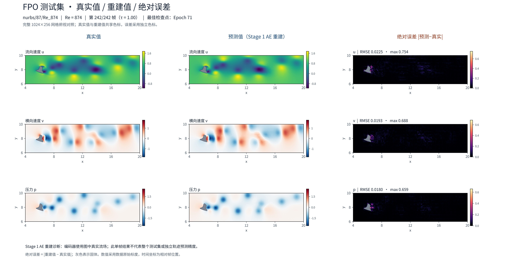

# Flow：复杂几何绕流的物理场表示与时序研究

[返回主页](../README.md) · [English overview](../README.en.md)

## 研究对象

Flow 项目研究复杂几何绕流的速度与压力场，使用几何的 SDF/mask、雷诺数 Re 与物理场表示。原始目标集合覆盖 `harmonics` 与 `nurbs` 两个几何家族，共 842 个工况、189 种几何，Re=103–999。

本页分别展示三种不同内容：原始仿真数据、真实场条件下的自编码器重建，以及两帧真实历史场条件下的单步预测评估。

## 原始仿真快照

上图来自 `harmonics/1/Re_603` 的原始数据，网格分辨率 1024 × 256。动画展示保存序号 1、81、161、242 的四个实际快照。它用于说明数据中的空间结构与时间变化，不代表模型推理结果。

速度幅值按 `sqrt(u²+v²)` 计算，所有帧共享固定色标。灰色为固体区域，由 `mask<0.5` 判定。坐标范围保留原数据的裁切域 `x∈[4,20], y∈[6,10]`。原始 NPZ 未提供已确认的物理时间，因此帧序号不换算为秒。

[查看速度与压力的完整时间快照图](../assets/flow/reference-time-sequence.png)

## Epoch 71：空间重建云图

| 项目 | 内容 |
| :--- | :--- |
| 任务 | Stage 1 自编码器重建 |
| 模型版本 | Epoch 71，冻结评估图册 |
| 展示工况 | `nurbs/87/Re_874`，测试集 |
| 展示时刻 | 零基帧索引 241，即第 242/242 帧 |
| 模型输入 | 几何、Re、当前展示时刻的真实流场 |
| 物理场 | 流向速度 u、横向速度 v、压力 p |
| 评估区域 | 原始 1024 × 256 网格的全部流体像素，排除固体 |

真实值与重建值共享色标；误差列采用独立色标。该任务检验空间表示能力，不能解释为只凭几何与 Re 预测未来流场。

该版本完整图册覆盖 85 个测试工况、20 种测试几何，全部工况按固定清单评估。网页展示工况用于说明图样，汇总结果包含全部 85 个测试工况，未按误差筛选。

[Epoch 71 全测试集末帧汇总](../results/flow-epoch071.json) · [展示工况指标与输入定义](../results/flow-displayed-case.json)

## Epoch 95：全测试集数值评估

较新的 Epoch 95 使用同一固定测试分区的 85 个工况。下表是原始存储尺度上的相对 L2，先在每个工况的全部被评估时空点上计算，再对工况等权平均。

| 任务 | 输入信息 | u | v | p |
| :--- | :--- | ---: | ---: | ---: |
| 全有效帧重建 | 几何、Re、当前真实场 | 1.373% | 3.247% | 3.500% |
| 连续段单步预测 | 几何、Re、两帧真实历史场、实际查询间隔 | 1.370% | 3.240% | 3.531% |

重建覆盖 20,570 个有效帧；单步预测覆盖 20,230 个合法连续时间窗口。单步窗口的历史帧和目标帧均位于原始帧索引 2 起的连续段。

该单步评估逐窗口提供真实历史场，不执行自由自回归滚动。其指标不能直接作为几何/Re 条件下长期预测的精度。当前展示的三列云图来自 Epoch 71，未替换成 Epoch 95 图像。

[Epoch 95 指标、统计范围与检查点哈希](../results/flow-epoch095.json)

## 后续研究重点

研究重点包括几何与 Re 条件下的初始状态表示、潜空间动力学、长期滚动稳定性，以及未见几何上的泛化评估。后续结果应按具体推理输入分别发布，并保留版本与评估口径。

Flow 数值采用数据原始存储尺度；本展示不将其标为未经独立核实的 SI 单位。全部素材的生成过程与来源见 [provenance.json](../results/provenance.json)。
