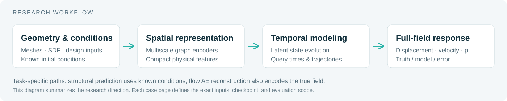

# 方法、素材生成与仓库结构

[返回主页](../README.md)

## 研究方法概览



结构案例以几何、设计参数和已知初始条件为输入，研究空间编码、潜空间演化和全场解码。Flow 案例研究复杂流体域上的多尺度空间表示，并单独评估真实历史场条件下的单步时序预测。实际模型输入与评估范围以各案例说明为准：

- [Car Crash](car-crash.md)：条件驱动的白车身未来位移场。
- [Bumper](bumper.md)：已知初始网格与静态工况下的整段位置轨迹。
- [Flow](flow.md)：重建、历史条件单步预测与原始仿真数据。

## 仓库结构

```text
TPLD-Surrogates/
├── README.md                  # 中文主页
├── README.en.md               # 英文主页
├── assets/
│   ├── branding/              # 横幅与方法示意图
│   ├── car-crash/             # GIF、完整对比图
│   ├── bumper/                # GIF、完整对比图、R²曲线
│   └── flow/                  # 重建对比与原始流场快照
├── docs/                      # 案例、评估口径与方法
├── results/                   # 指标摘要、逐帧表、素材来源
└── scripts/                   # 素材生成与完整性检查
```

## 重新生成展示素材

阅读 GitHub 页面不需要安装依赖。重新生成素材需要本地已有的研究导出目录：

```text
SOURCE_ROOT/
├── 100_Car_Crash/Car_Crash_1026/
├── 131_bumper/Bumper_Visualization/
└── Flow/analysis/
```

在仓库目录执行：

```powershell
python -m pip install -r requirements-showcase.txt
python scripts/build_showcase.py --source-root "D:/research"
python scripts/verify_showcase.py
```

将示例路径替换为实际研究目录。脚本只读取研究目录，并写入本仓库的 `assets/` 和 `results/`，不执行训练或模型推理。

结构动图从原图裁取首个视角的预测、真实值与误差三列，保留色标。全部保存帧按时间顺序生成 GIF，无时间插值。完整 PNG 保留原始字节，用于科学读图。

Flow 动图直接渲染已有 NPZ 中四个真实快照，共用固定速度色标；固体区域从色标范围计算中排除。每张素材附任务类型，便于单独分享时保留上下文。

`results/provenance.json` 记录源文件与发布资产的哈希、转换方式及时间政策。当前脚本生成与检查展示包；不提供完整模型训练的可复现实验环境。
